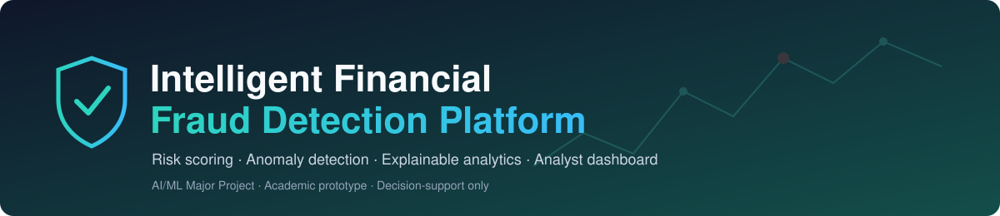
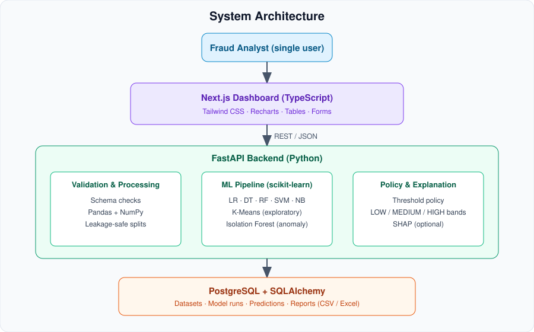
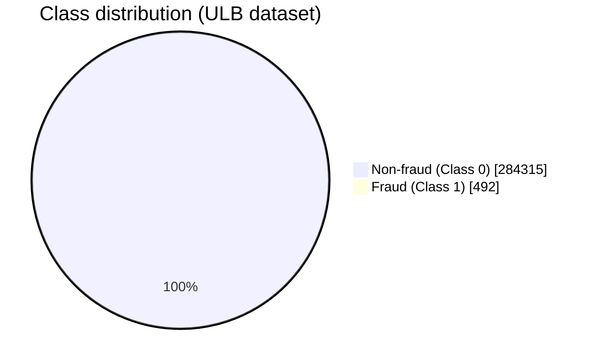

<div align="center">



<br/>


**Machine-learning-based transaction risk analysis, fraud classification, anomaly detection and explainable analytics.**

</div>

---

## 📑 Table of Contents

1. [Overview](#-overview)
2. [Key Features](#-key-features)
3. [How It Works](#-how-it-works)
4. [Architecture at a Glance](#-architecture-at-a-glance)
5. [Technology Stack](#-technology-stack)
6. [Dataset](#-dataset)
7. [Project Structure](#-project-structure)
8. [Quick Start](#-quick-start)
9. [Documentation Index](#-documentation-index)
10. [Scope and Disclaimer](#-scope-and-disclaimer)

---

## 🎯 Overview

Financial institutions process enormous transaction volumes, so manual review of every record is impractical. Fixed rules miss complex patterns and also flag legitimate customers. This project is an **academic prototype** that:

- learns fraud patterns from **labeled historical data**,
- estimates **fraud probability** for new transactions,
- surfaces **unusual transactions** with a separate anomaly signal, and
- presents everything in an **analyst-oriented dashboard** with exportable reports.

> [!IMPORTANT]
> The system supports analyst review. It **does not** connect to a bank and **never** blocks, reverses or authorizes real payments.

## ✨ Key Features

| | Feature | Summary |
|---|---|---|
| 🔐 | Single-user authentication | Secure login/logout with hashed passwords |
| 📤 | Dataset upload | CSV/Excel validation of extension, size, columns, data types |
| 🔎 | Data inspection | Row count, missing values, duplicates, class balance, preview |
| 🧪 | Leakage-safe preprocessing | Train-only fitting inside scikit-learn pipelines |
| 🤖 | Multi-model training | Logistic Regression, Decision Tree, Random Forest, SVM, Naive Bayes |
| 📊 | Imbalance-aware evaluation | Confusion matrix, precision, recall, F1, ROC-AUC, PR-AUC |
| 🎯 | Single and batch prediction | Same preprocessing pipeline as training |
| 🚨 | Anomaly detection | Isolation Forest, shown separately from fraud predictions |
| 🕵️ | Investigation view | Features, model output, explanation signals |
| 📁 | Reports and history | CSV/Excel export, persisted model-run metrics |

## 🔄 How It Works

<div align="center">

</div>

## 🏗️ Architecture at a Glance

<div align="center">

</div>

See [`docs/ARCHITECTURE.md`](docs/ARCHITECTURE.md) for sequence diagrams and module boundaries.

## 🧰 Technology Stack

| Layer | Technology | Purpose |
|---|---|---|
| Frontend | Next.js + TypeScript | Dashboard, forms, tables, investigation views |
| Styling | Tailwind CSS | Responsive, consistent UI |
| Charts | Recharts | Risk distribution, model comparison |
| Backend | Python + FastAPI | Dataset, prediction, metrics, report endpoints |
| Data | Pandas + NumPy | Inspection, cleaning, feature preparation |
| ML | scikit-learn | Classification, clustering, anomaly detection, evaluation |
| Explainability | SHAP *(optional)* | Feature-contribution explanations |
| Database | PostgreSQL + SQLAlchemy | Metadata, model runs, predictions, reports |
| Export | XlsxWriter / openpyxl | Excel reports |
| DevOps | Git + GitHub, Docker *(optional)* | Source control, packaging |

## 📦 Dataset

Recommended: **[Kaggle Credit Card Fraud Detection (ULB)](https://www.kaggle.com/datasets/mlg-ulb/creditcardfraud)**: 284,807 European card transactions, 492 labeled frauds (≈ 0.173 %).



Features `V1–V28` are **anonymized**. The first version must not claim to use merchant, device, location or customer-identity data. Details: [`docs/DATASET.md`](docs/DATASET.md).

## 🗂️ Project Structure

```text
fraud-detection-platform/
├── README.md
├── assets/                     # banner and diagrams
├── docs/                       # full documentation set (see index below)
├── backend/                    # FastAPI app, ML pipeline, DB layer
│   ├── app/
│   │   ├── api/                # route handlers
│   │   ├── core/               # config, security
│   │   ├── data/               # validation, preprocessing
│   │   ├── ml/                 # training, evaluation, anomaly, policy
│   │   ├── db/                 # SQLAlchemy models, sessions
│   │   └── reports/            # CSV/Excel export
│   ├── notebooks/              # EDA and evaluation notebooks
│   └── tests/
├── frontend/                   # Next.js + TypeScript dashboard
│   └── src/{app,components,lib}/
├── docker-compose.yml          # optional
└── .env.example
```

> The layout is a recommended starting point; the PRD only requires UI, API, data processing and ML code to live in separate modules.

## 🚀 Quick Start

```bash
git clone <your-repo-url> fraud-detection-platform && cd fraud-detection-platform
cp .env.example .env                       # fill in secrets locally

# Backend
cd backend && python -m venv .venv && source .venv/bin/activate
pip install -r requirements.txt
uvicorn app.main:app --reload              # http://localhost:8000/docs

# Frontend (new terminal)
cd frontend && npm install && npm run dev  # http://localhost:3000
```

Full instructions, environment variables and Docker setup: [`docs/SETUP.md`](docs/SETUP.md).

## 📚 Documentation Index

| Document | What it covers |
|---|---|
| [Architecture](docs/ARCHITECTURE.md) | Components, data flow, sequence diagrams |
| [Dataset](docs/DATASET.md) | ULB dataset, schema, imbalance, constraints |
| [ML Pipeline](docs/ML_PIPELINE.md) | Splits, algorithms, metrics, thresholds, reproducibility |
| [API Reference](docs/API.md) | Endpoints, payloads, errors |
| [Database](docs/DATABASE.md) | ER diagram and entity definitions |
| [UI Design](docs/UI_DESIGN.md) | Pages, navigation, wireframes |
| [Testing](docs/TESTING.md) | Strategy, test matrix, acceptance checklist |
| [Roadmap](docs/ROADMAP.md) | Eleven dependency-ordered phases |
| [Limitations & Ethics](docs/LIMITATIONS.md) | Scope boundaries, risks, mitigations |
| [Setup & Deployment](docs/SETUP.md) | Local and Docker instructions |
| [Lab Mapping](docs/LAB_MAPPING.md) | Lab experiments vs. project usage |
| [Viva Notes](docs/VIVA_NOTES.md) | Faculty-ready explanation and Q&A |

## ⚖️ Scope and Disclaimer

- Academic prototype only; **not** connected to real bank or payment systems.
- A high predicted probability is a **model estimate, not proof of fraud**.
- Anomaly detection flags *unusual* records, not necessarily criminal activity.
- Results on one public dataset do not guarantee performance elsewhere.
- Judged on reproducibility, honest evaluation and clear documentation, **not** on a fabricated accuracy target.

---

<div align="center"><sub>Intelligent Financial Fraud Detection Platform · PRD v1.0 · AI/ML Major Project</sub></div>
