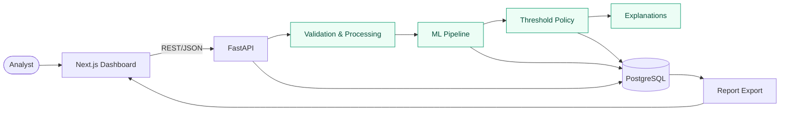
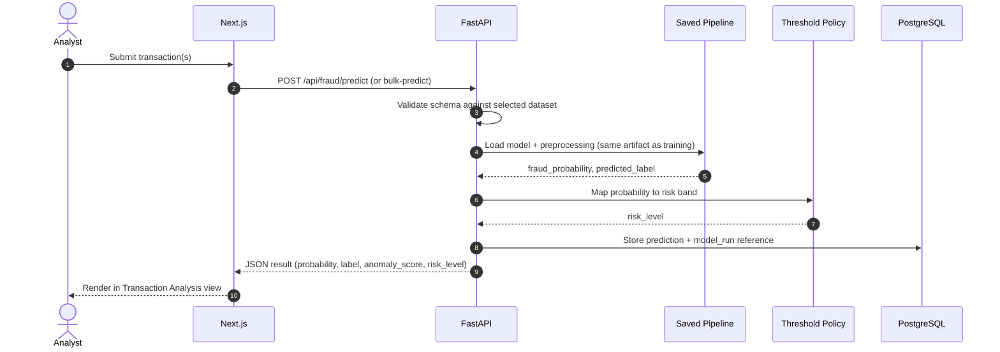
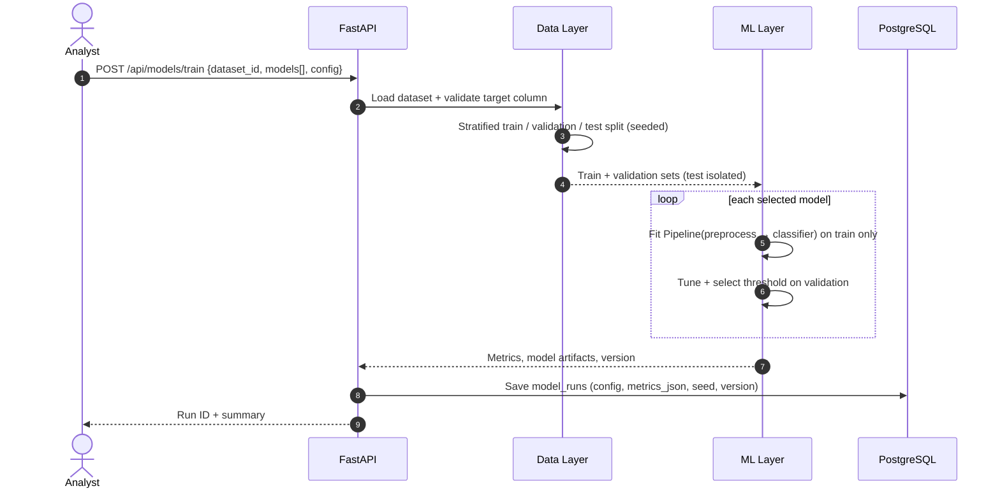
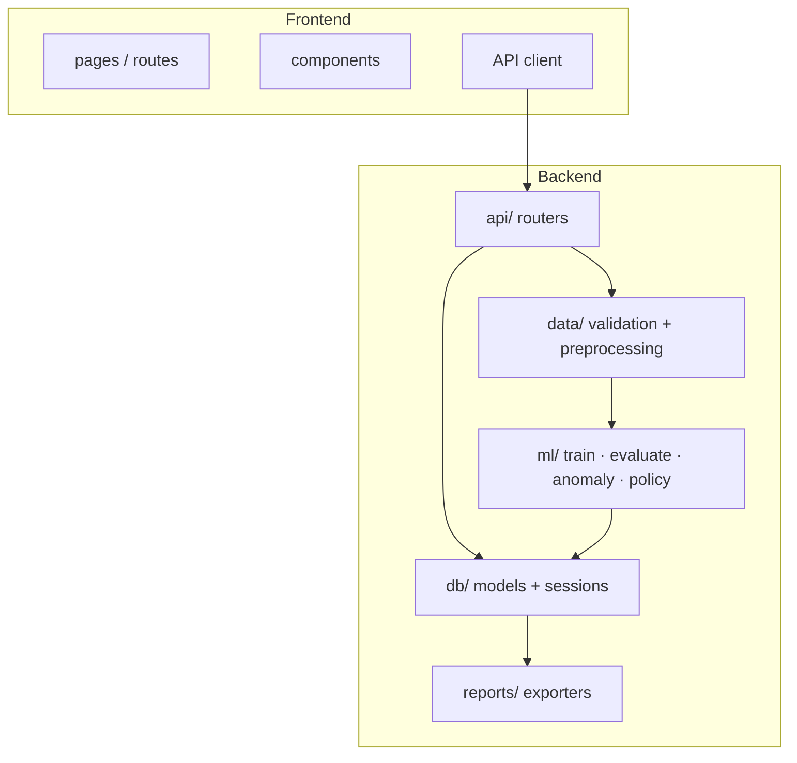

# 🏗️ System Architecture

> Part of the [Intelligent Financial Fraud Detection Platform](../README.md) documentation.

**Contents:** [Overview](#overview) · [Components](#components) · [Data flow](#data-flow) · [Prediction sequence](#prediction-sequence) · [Training sequence](#training-sequence) · [Module boundaries](#module-boundaries) · [Design decisions](#design-decisions) · [Security](#security)

---

## Overview

A single-user web application: a **Next.js** dashboard talks to a **FastAPI** backend over REST/JSON. The backend validates data, runs the scikit-learn pipeline, applies a threshold policy, and persists results to **PostgreSQL**.

## Components

| Component | Responsibility | Technology |
|---|---|---|
| Dashboard | Forms, tables, charts, investigation views | Next.js, TypeScript, Tailwind, Recharts |
| API layer | Auth, routing, request validation, error mapping | FastAPI |
| Data layer | Schema validation, cleaning, feature preparation | Pandas, NumPy |
| ML layer | Training, evaluation, prediction, clustering, anomaly detection | scikit-learn |
| Policy layer | Threshold policy and risk bands (LOW / MEDIUM / HIGH) | Python module, configurable |
| Explanation layer | Feature-contribution signals where supported | SHAP *(optional)* |
| Persistence | Dataset metadata, model runs, predictions, reports | PostgreSQL, SQLAlchemy |
| Export | CSV / Excel reports | XlsxWriter / openpyxl |

## Data Flow

## Prediction Sequence

## Training Sequence

## Module Boundaries

The PRD requires UI, API, data processing and ML training code to stay in **separate modules**.

Rules of thumb:

- Routers contain **no ML logic**; they call services.
- ML code has **no HTTP or database imports** (keeps it testable in notebooks).
- Preprocessing lives **inside** the persisted scikit-learn `Pipeline`, so training and serving cannot drift.

## Design Decisions

| Decision | Rationale |
|---|---|
| Separate supervised and anomaly outputs | An anomaly is not a fraud label; mixing them would overclaim |
| Persist the full pipeline (preprocess + model) | Guarantees identical transforms at prediction time; supports reload-consistency tests |
| Configurable risk thresholds | Risk bands are application-level categories, not financial standards |
| Record seed, config, dataset version per run | Reproducibility requirement |
| Single user role | Initial scope excludes customer, admin and manager roles |

## Security

- Hash passwords (e.g. bcrypt/argon2); never store plaintext.
- Validate upload extension, size, columns and dtypes before processing.
- Keep secrets in **environment variables**, never in source control.
- Avoid exposing raw sensitive data; store only what the schema needs.
- Protect all non-login endpoints with token/session authentication.
