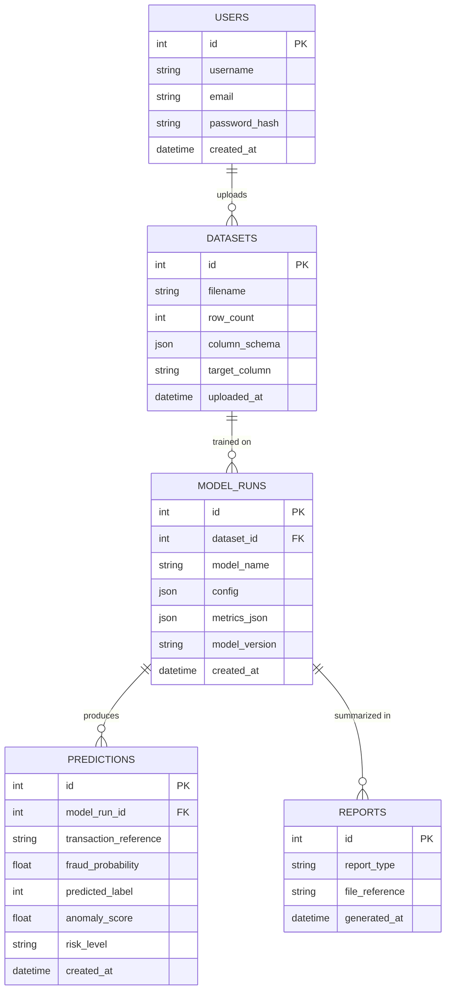

# 🗄️ Database Design

> Part of the [Intelligent Financial Fraud Detection Platform](../README.md) documentation.

PostgreSQL + SQLAlchemy. The schema below is a **starting point**; adjust it to the chosen dataset and retention requirements. Avoid storing unnecessary personal or payment-card data.

## Entity-Relationship Diagram



> The `USERS → DATASETS` link and the `MODEL_RUNS → REPORTS` link are **proposed relationships**; the PRD lists the entities and key fields but not explicit foreign keys. Add `user_id` to `datasets` only if you want ownership tracking.

## Entity Reference

| Entity | Key fields (from PRD) | Purpose |
|---|---|---|
| `users` | id, username, email, password_hash, created_at | The single analyst account |
| `datasets` | id, filename, row_count, column_schema, target_column, uploaded_at | Dataset metadata (FR-12) |
| `model_runs` | id, dataset_id, model_name, config, metrics_json, model_version, created_at | Reproducible training record |
| `predictions` | id, model_run_id, transaction_reference, fraud_probability, predicted_label, anomaly_score, risk_level, created_at | Prediction history |
| `reports` | id, report_type, file_reference, generated_at | Exported reports |

## Reproducibility Fields

Store inside `model_runs.config` / `metrics_json`:

```json
{
  "dataset_version": "<identifier>",
  "random_seed": 42,
  "preprocessing": { "scaler": "StandardScaler" },
  "hyperparameters": {},
  "threshold_policy": { "t_medium": null, "t_high": null },
  "metrics": { "precision": null, "recall": null, "f1": null, "pr_auc": null, "roc_auc": null }
}
```

## Design Notes

- Store **metadata and outputs**, not duplicate raw datasets.
- Index `predictions(model_run_id)` and `predictions(risk_level)` for dashboard queries.
- Keep `password_hash` only; never plaintext.
- Use migrations (e.g. Alembic) so schema changes are tracked.
