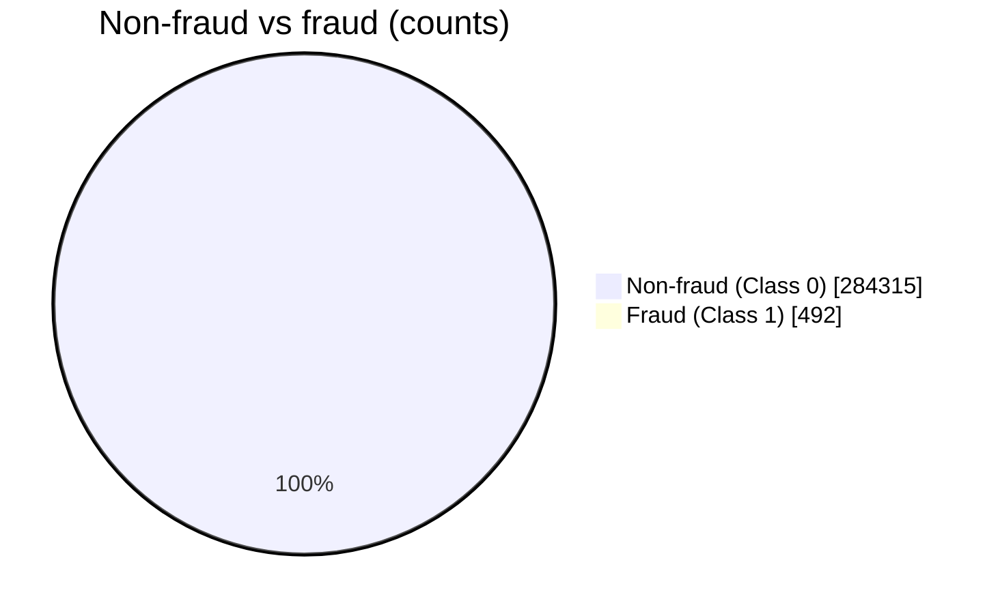

# 📦 Dataset Specification

> Part of the [Intelligent Financial Fraud Detection Platform](../README.md) documentation.

## Recommended Dataset

**Kaggle: Credit Card Fraud Detection (ULB / MLG-ULB)**
🔗 <https://www.kaggle.com/datasets/mlg-ulb/creditcardfraud>

> Access may require a Kaggle account and acceptance of the dataset terms. Confirm license and access in **Phase 1**.

| Property | Value |
|---|---|
| Transactions | 284,807 (European card transactions) |
| Labeled fraud cases | 492 |
| Fraud rate | ≈ 0.173 % |
| Target column | `Class` (0 = non-fraud, 1 = fraud) |
| Common columns | `Time`, `Amount`, `V1`–`V28`, `Class` |

## Class Distribution

### ⚠️ The accuracy trap

A model that predicts **every transaction as non-fraud** is correct on 284,315 of 284,807 records, roughly **99.83 % accuracy**, while detecting **zero** fraud. This is why evaluation must emphasize **precision, recall, F1, confusion matrix, PR-AUC and ROC-AUC** (see [ML Pipeline](ML_PIPELINE.md#evaluation-metrics)).

## Schema

| Column | Type | Meaning |
|---|---|---|
| `Time` | numeric | Seconds elapsed since the first transaction in the dataset |
| `V1`–`V28` | numeric | Anonymized, transformed features |
| `Amount` | numeric | Transaction amount |
| `Class` | integer (0/1) | Label: 0 = non-fraud, 1 = fraud |

## Constraints

> [!IMPORTANT]
> `V1`–`V28` are anonymized transformed features. The dataset does **not** provide raw **merchant, device, location, customer identity or payment-method** fields.

Consequences:

- The first version **must not claim** to use unavailable fields.
- Explanations are limited to anonymized features and `Amount`/`Time`; do not invent human-readable stories.
- If human-readable behavioral features are required, **choose a richer dataset and revise this specification before implementation**.

## Data Quality Checklist

| Check | Where it appears |
|---|---|
| File extension (CSV/Excel) and size limit | Upload validation (FR-02) |
| Required columns present | Upload validation (FR-02) |
| Data types as expected | Upload validation (FR-02) |
| Row count, missing values, duplicates | Data inspection (FR-03) |
| Class balance | Data inspection (FR-03) |
| Empty file / unexpected categories | Error-handling tests |

## Handling Imbalance

- **Stratified** splitting preserves the fraud ratio in every split.
- Class weights or resampling are applied **only inside the training data**, never before the split.
- Choose thresholds on validation data using the precision/recall trade-off.

## Data Dictionary Template (Phase 2 deliverable)

| Field | Type | Range / values | Missing | Notes |
|---|---|---|---|---|
| Time | float | *(fill after EDA)* | | |
| Amount | float | *(fill after EDA)* | | Consider scaling |
| V1–V28 | float | *(fill after EDA)* | | Anonymized |
| Class | int | {0, 1} | | Target |

## Privacy

Avoid storing unnecessary personal or payment-card data. For this dataset, persist dataset **metadata** and prediction outputs, not repeated raw copies.
