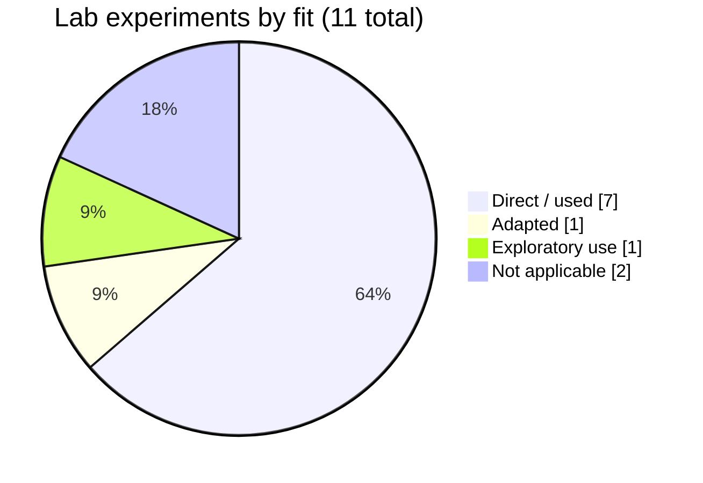
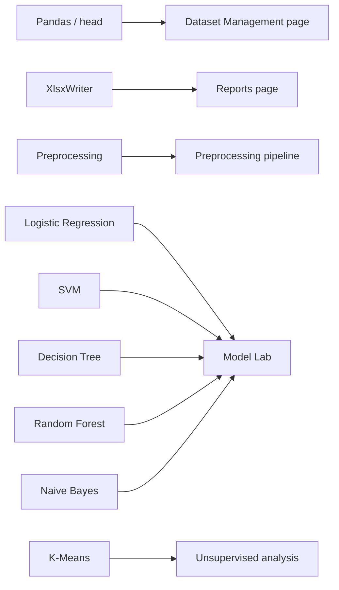

# 🧪 Lab Experiment Mapping

> Part of the [Intelligent Financial Fraud Detection Platform](../README.md) documentation.

How the lab experiments connect to this project. Experiments that do not fit are **not forced** into scope.

## Mapping Table

| # | Experiment | Fit | Usage in project |
|:--:|---|:--:|---|
| 1 | Pandas DataFrame / `head()` | ✅ Direct | Dataset inspection and preview |
| 2 | Pandas + XlsxWriter | ✅ Direct | Excel report export |
| 3 | Preprocessing / scaling / split | ✅ Direct | Transformations fitted on training data only |
| 4 | Simple Linear Regression | ⛔ Not natural | Not required for fraud classification; do not force it in |
| 5 | Logistic Regression | ✅ Direct | Baseline fraud classifier |
| 6 | Digit recognition | ⛔ Not relevant | Outside the transaction domain |
| 7 | SVM | 🔄 Adapted | Fraud-vs-legitimate classification |
| 8 | Decision Tree | ✅ Direct | Interpretable classifier |
| 9 | Random Forest | ✅ Direct | Primary candidate classifier |
| 10 | Naive Bayes | ✅ Comparison | Benchmark classifier |
| 11 | K-Means | ✅ Exploratory | Transaction segmentation, **not** fraud labels |

## Coverage

*Counts: Direct = #1, 2, 3, 5, 8, 9, 10; Adapted = #7; Exploratory = #11; Not applicable = #4, 6.*

## Where Each Appears

## Note for Submission

State clearly in the report which experiments are **directly used**, which are **adapted**, and why experiments 4 and 6 are **intentionally not included**.
