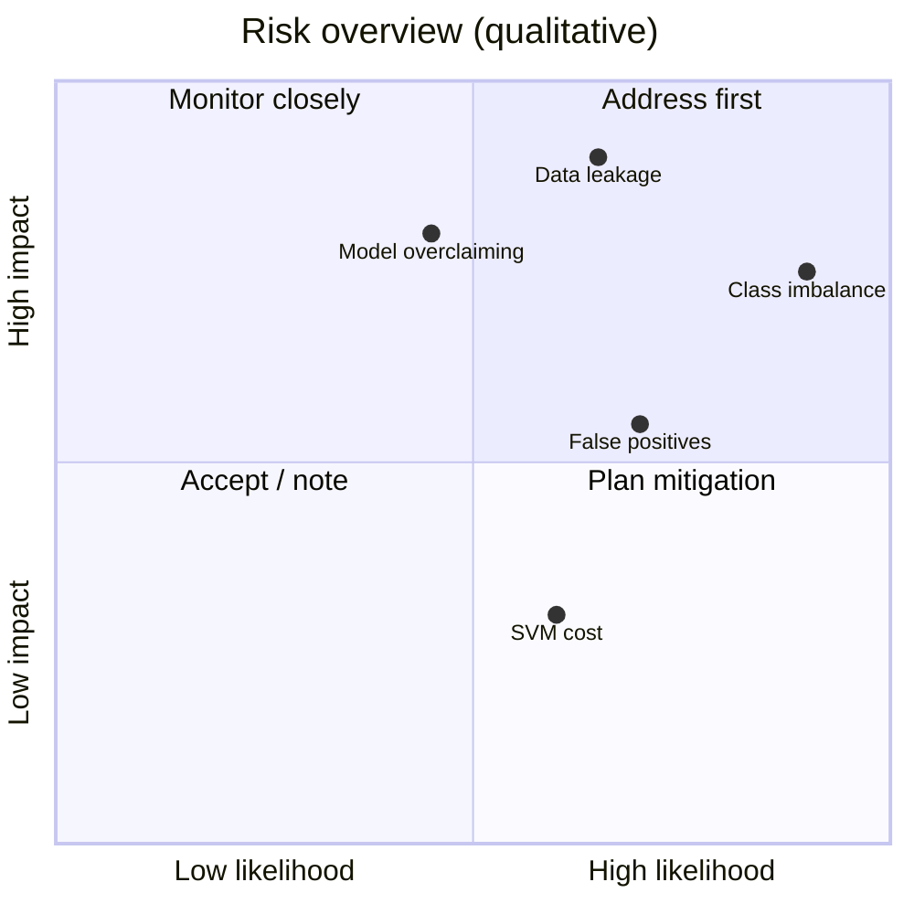

# ⚖️ Scope, Limitations & Ethics

> Part of the [Intelligent Financial Fraud Detection Platform](../README.md) documentation.

> [!WARNING]
> This is an **academic decision-support prototype**. It must not be used to make real financial decisions.

## Scope Boundaries

| ✅ In scope | ❌ Out of scope |
|---|---|
| Single-user analyst workflow | Customer, admin or manager roles |
| Public dataset analysis | Connection to real bank/payment systems |
| Risk estimates and anomaly signals | Automatically blocking, reversing or authorizing transactions |
| CSV/Excel export (PDF optional) | Production-grade compliance and monitoring |

## Limitations

- A high predicted probability is a **model estimate, not proof of fraud**.
- Anomaly detection flags **unusual** records, not necessarily criminal activity.
- Dataset limitations constrain which explanations and features are valid (anonymized `V1–V28`).
- Performance on one public dataset **does not guarantee** performance on other institutions or future transactions.
- Real deployment would require additional **privacy, compliance, security, monitoring and human-review** controls.

## Risks and Mitigations

| Risk | Mitigation |
|---|---|
| Severe class imbalance | Stratified splitting; class weights/resampling **only within training data**; PR-AUC, recall, precision |
| Data leakage | scikit-learn pipelines; fit transformations on training data only |
| Anonymized features limit explanation | State limitations clearly; do not invent merchant/device/location details |
| SVM training cost | Benchmark a suitable sample or optimize settings; document the choice |
| False positives | Expose precision/recall trade-off; route high-risk cases to human review |
| Model overclaiming | Report test results honestly; avoid guarantees of detection |

*Positions are a qualitative planning aid, not measured values.*

## Responsible-Use Principles

1. **Human in the loop:** the analyst decides; the model advises.
2. **Honest reporting:** publish results, including weaknesses.
3. **No fabricated claims:** no accuracy targets; no features the data doesn't contain.
4. **Privacy by default:** minimize stored personal or card data; secrets in env vars.
5. **Transparency:** every prediction view carries the decision-support disclaimer.
