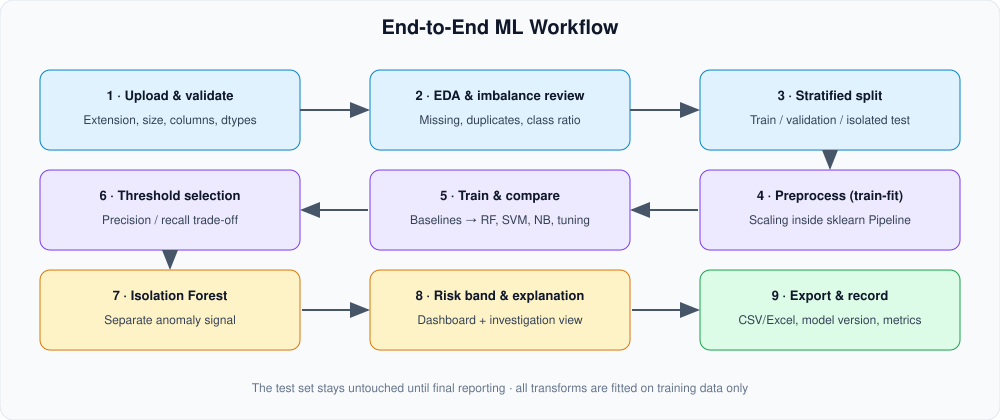
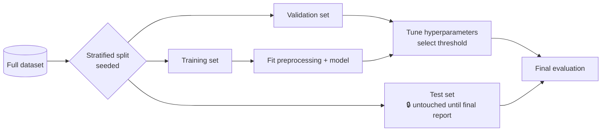
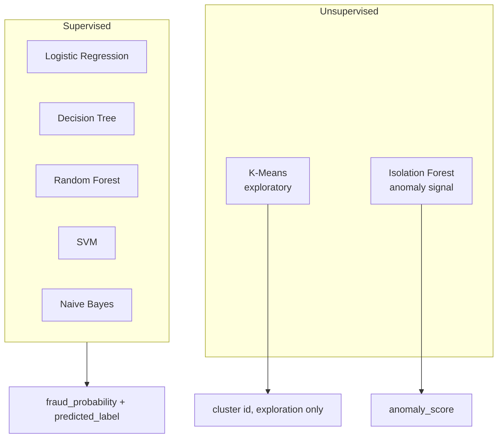
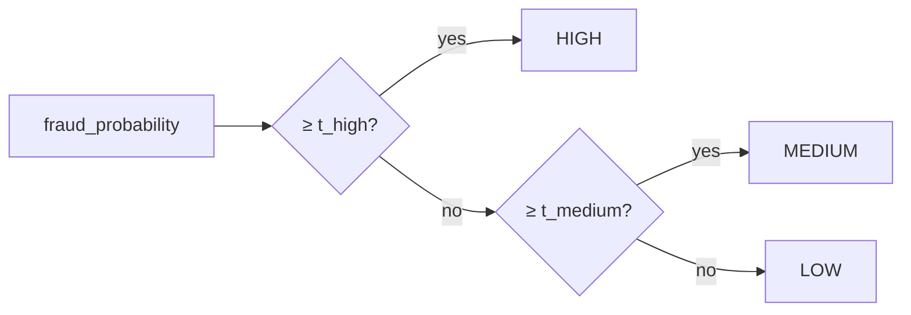
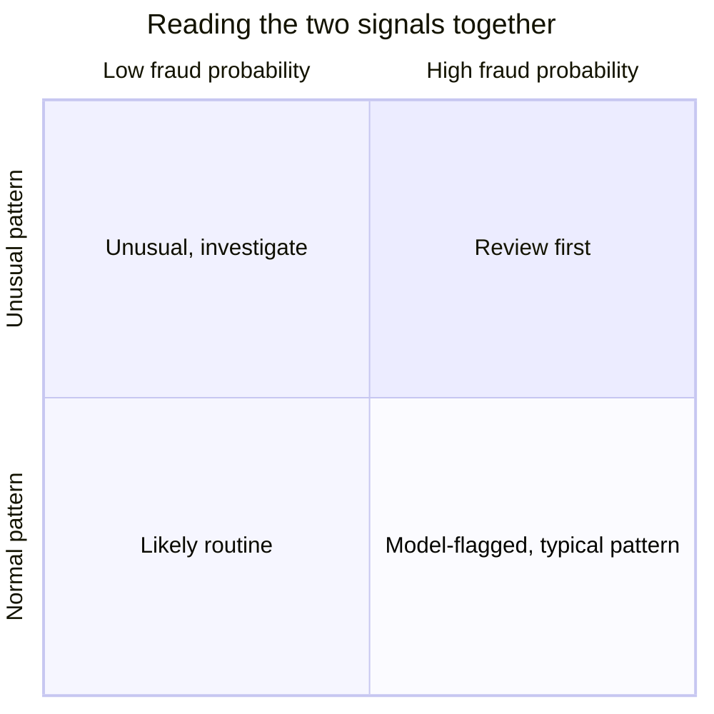

# 🤖 Machine-Learning Pipeline

> Part of the [Intelligent Financial Fraud Detection Platform](../README.md) documentation.

**Contents:** [Workflow](#workflow) · [Split strategy](#split-strategy) · [Leakage control](#leakage-control) · [Algorithms](#algorithms) · [Evaluation metrics](#evaluation-metrics) · [Threshold and risk policy](#threshold-and-risk-policy) · [Anomaly detection](#anomaly-detection) · [Reproducibility](#reproducibility) · [Results template](#results-template)

---

## Workflow

<div align="center">

</div>

## Split Strategy



- Use a **stratified** split for labeled data and **document the random seed**.
- Cross-validation or a validation set is used for tuning and threshold selection.
- The test set is used **once**, for final reporting.

## Leakage Control

All transformations (scaling, encoding, imputation, resampling) are fitted on **training data only**. Use scikit-learn `Pipeline` so this is automatic.

```python
# Illustrative skeleton, adjust to the final feature set
from sklearn.model_selection import train_test_split
from sklearn.pipeline import Pipeline
from sklearn.preprocessing import StandardScaler
from sklearn.linear_model import LogisticRegression

SEED = 42
X, y = df.drop(columns=["Class"]), df["Class"]

X_train, X_test, y_train, y_test = train_test_split(
    X, y, test_size=0.2, stratify=y, random_state=SEED
)

pipe = Pipeline([
    ("scale", StandardScaler()),                 # fitted on X_train only
    ("clf", LogisticRegression(class_weight="balanced", max_iter=1000, random_state=SEED)),
])
pipe.fit(X_train, y_train)
proba = pipe.predict_proba(X_test)[:, 1]
```

> The split ratio and class-weight choice above are examples. Final values must be documented with the model run.

## Algorithms

| Algorithm | Role | Notes |
|---|---|---|
| **Logistic Regression** | Baseline supervised classifier | Probability estimate when calibrated/used appropriately; scaling usually helps |
| **Decision Tree** | Interpretable classifier | Can expose decision paths; limit depth to reduce overfitting |
| **Random Forest** | Primary candidate classifier | Tune class weighting and threshold as needed |
| **SVM** | Comparison classifier | Can be expensive on the full dataset; use a documented sample or optimized configuration |
| **Naive Bayes** | Benchmark classifier | Independence assumptions may limit performance on correlated features |
| **K-Means** | Behavioral clustering | Exploratory segmentation only; clusters are **not** fraud labels |
| **Isolation Forest** | Anomaly detection | An anomaly does **not** mean fraud; separate signal |

> Model selection is based on **validation results** and the **cost of false positives vs missed fraud**, not on a pre-decided claim that one algorithm is always best.



## Evaluation Metrics

| Metric | Why it matters here |
|---|---|
| Confusion matrix | Shows false positives (legit flagged) vs false negatives (fraud missed) |
| Precision | Of flagged transactions, how many are truly fraud |
| Recall | Of true frauds, how many were caught |
| F1 | Balance of precision and recall |
| **PR-AUC** | Most informative under severe imbalance |
| ROC-AUC | Ranking quality across thresholds |
| Class counts | Always reported alongside metrics |
| ~~Accuracy alone~~ | Misleading under imbalance, never the sole metric |

```text
                     Predicted
                 Non-fraud     Fraud
Actual  Non-fraud     TN          FP   ← legitimate transactions flagged
        Fraud         FN          TP
                      ↑
               fraud missed
```

## Threshold and Risk Policy

Probability → label requires a **threshold chosen on validation data**, based on the precision/recall trade-off and the relative cost of FP vs FN.

Risk labels (**LOW / MEDIUM / HIGH**) are **application-level categories** derived from a documented threshold policy. They are not universal financial standards and must be **configurable** (Settings page) after validation.

| Band | Policy (to be set after validation) | Analyst action |
|---|---|---|
| LOW | probability below `t_medium` | No review needed |
| MEDIUM | between `t_medium` and `t_high` | Optional review |
| HIGH | at or above `t_high` | Route to review queue |



## Anomaly Detection

- **Isolation Forest** runs separately and outputs an `anomaly_score`.
- The UI shows it as an **"unusual record" signal**, never as a confirmed fraud label.
- A transaction can be *anomalous but low-risk*, or *high-risk but not anomalous*; both are valid.



## Reproducibility

Record for every model run:

- dataset identifier / version and row counts
- preprocessing settings
- model name and hyperparameters
- **random seed**
- evaluation metrics (validation and final test)
- model version and threshold policy

Verify that the **saved model and preprocessing pipeline produce identical predictions after reload**.

## Results Template

> Fill after Phase 5. Do not pre-fill with targets; report honestly.

| Model | Precision | Recall | F1 | PR-AUC | ROC-AUC | Train time | Notes |
|---|---|---|---|---|---|---|---|
| Logistic Regression | | | | | | | baseline |
| Decision Tree | | | | | | | |
| Random Forest | | | | | | | |
| SVM | | | | | | | sample/config documented |
| Naive Bayes | | | | | | | |

Include class counts and confusion matrices for each model.
