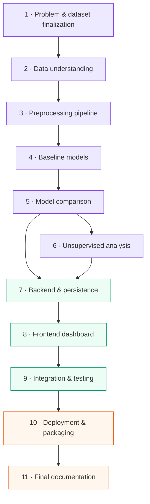

# 🗺️ Implementation Roadmap

> Part of the [Intelligent Financial Fraud Detection Platform](../README.md) documentation.

Phases are ordered by **dependency**, not calendar duration. Proceed when the stated deliverable has been **reviewed and tested**.

## Dependency Graph

🟣 ML track · 🟢 Application track · 🟠 Delivery track

## Phase Details

### Phase 1: Problem and dataset finalization
- [ ] Confirm dataset license/access
- [ ] Confirm target column, feature definitions, class balance
- [ ] Define project boundaries

**Exit:** dataset selected; schema and limitations documented.

### Phase 2: Data understanding
- [ ] Load data; inspect distributions, missing values, duplicates, target balance
- [ ] Document feature meaning

**Exit:** EDA notebook/report and validated data dictionary.

### Phase 3: Preprocessing pipeline
- [ ] Reproducible preprocessing, train/test strategy, feature pipeline
- [ ] Leakage controls with tests

**Exit:** reusable pipeline with leakage controls and tests.

### Phase 4: Baseline models
- [ ] Train Logistic Regression and Decision Tree
- [ ] Establish initial metrics

**Exit:** baseline results and evaluation notebook.

### Phase 5: Model comparison
- [ ] Train Random Forest, SVM, Naive Bayes
- [ ] Compare threshold and metric trade-offs

**Exit:** comparison table, confusion matrices, selected-model rationale.

### Phase 6: Unsupervised analysis
- [ ] K-Means exploration
- [ ] Isolation Forest anomaly detection (kept distinct from fraud labels)

**Exit:** cluster/anomaly results with documented interpretation.

### Phase 7: Backend and persistence
- [ ] FastAPI endpoints, model loading
- [ ] PostgreSQL entities, validation, prediction history

**Exit:** tested API and database integration.

### Phase 8: Frontend dashboard
- [ ] Login, dataset upload, dashboard, model comparison, transaction analysis, reports

**Exit:** working single-user UI connected to the API.

### Phase 9: Integration and testing
- [ ] Upload errors, prediction flow, model reload, metric correctness, access control, export

**Exit:** test evidence and resolved critical defects.

### Phase 10: Deployment and packaging
- [ ] Containerize if useful; configure environment variables
- [ ] Document setup/deployment; prepare demo dataset

**Exit:** reproducible deployment instructions and a runnable build.

### Phase 11: Final documentation
- [ ] Report, diagrams, screenshots, limitations, results, PPT, viva notes

**Exit:** submission-ready project documentation.

## Progress Tracker

| Phase | Status | Notes |
|:--|:--:|:--|
| 1 · Problem & dataset | ⬜ | |
| 2 · Data understanding | ⬜ | |
| 3 · Preprocessing | ⬜ | |
| 4 · Baselines | ⬜ | |
| 5 · Model comparison | ⬜ | |
| 6 · Unsupervised | ⬜ | |
| 7 · Backend | ⬜ | |
| 8 · Frontend | ⬜ | |
| 9 · Integration & testing | ⬜ | |
| 10 · Deployment | ⬜ | |
| 11 · Final docs | ⬜ | |

Legend: ⬜ not started · 🟨 in progress · ✅ done
