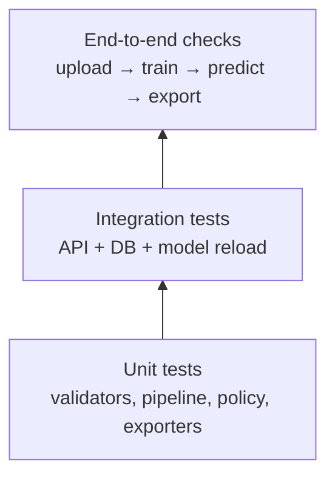

# ✅ Testing & Acceptance

> Part of the [Intelligent Financial Fraud Detection Platform](../README.md) documentation.

## Evaluation Strategy

- Stratified split for labeled data; **document the random seed**.
- Fit preprocessing **only on training data**.
- Use cross-validation or a validation set for tuning and threshold selection.
- Keep the final test set **untouched** until final reporting.
- Report confusion matrix, precision, recall, F1, ROC-AUC, PR-AUC **with class counts**.
- Compare false positives (legit flagged) with false negatives (fraud missed).

## Test Pyramid



## Test Matrix

| Area | Test | Expected result | Req. |
|---|---|---|---|
| Upload | Wrong extension | Clear error | FR-02 |
| Upload | Empty file | Clear error | FR-02 |
| Upload | Missing required columns | Error naming missing columns | FR-02 |
| Upload | Wrong data types | Validation error | FR-02 |
| Upload | Oversized file | Rejected with size message | FR-02 |
| Inspection | Known small CSV | Correct row count, missing, duplicates, balance | FR-03 |
| Preprocessing | Fit on train only | No test statistics in scaler params | FR-04 |
| Preprocessing | Unexpected categories | Handled or rejected gracefully | FR-04 |
| Training | Same seed twice | Same metrics | FR-05 |
| Evaluation | Hand-built confusion matrix | Metrics match manual calculation | FR-06 |
| Prediction | Schema mismatch | Clear error | FR-07 |
| Prediction | Reload saved pipeline | Identical predictions to pre-save | FR-07 |
| Anomaly | Isolation Forest output | Stored as separate `anomaly_score` | FR-08 |
| Dashboard | Aggregates | Match database counts | FR-09 |
| Reports | Export CSV/Excel | File opens; columns correct | FR-11 |
| History | Restart app | Runs and predictions persist | FR-12 |
| Security | No/invalid token | 401 on protected endpoints | FR-01 |
| Security | Password storage | Only hash stored | NFR |

## Example Leakage Test

```python
def test_scaler_fit_on_train_only(split):
    X_train, X_test = split.X_train, split.X_test
    pipe = build_pipeline().fit(X_train, split.y_train)
    scaler = pipe.named_steps["scale"]
    assert np.allclose(scaler.mean_, X_train.mean(axis=0))      # train stats only
    assert not np.allclose(scaler.mean_, np.vstack([X_train, X_test]).mean(axis=0))
```

## Example Reload-Consistency Test

```python
def test_reload_consistency(tmp_path, pipe, X_sample):
    before = pipe.predict_proba(X_sample)
    joblib.dump(pipe, tmp_path / "model.joblib")
    after = joblib.load(tmp_path / "model.joblib").predict_proba(X_sample)
    np.testing.assert_allclose(before, after)
```

## Acceptance Criteria Checklist

- [ ] 1. The selected dataset loads and its schema/limitations are documented.
- [ ] 2. The preprocessing pipeline runs without leakage between training and test data.
- [ ] 3. At least **three** supervised models train and produce comparable evaluation metrics.
- [ ] 4. The report includes class imbalance and metrics beyond accuracy.
- [ ] 5. Isolation Forest output is shown as an **anomaly signal**, not a confirmed fraud label.
- [ ] 6. The user can upload data, run predictions, inspect results and export reports through the UI.
- [ ] 7. The system handles invalid inputs gracefully and records model-run metadata.
- [ ] 8. Documentation states predictions are **decision-support estimates, not proof of fraud**.

## Definition of Done (per phase)

A phase is complete when its **deliverable has been reviewed and tested** (see [Roadmap](ROADMAP.md)).
