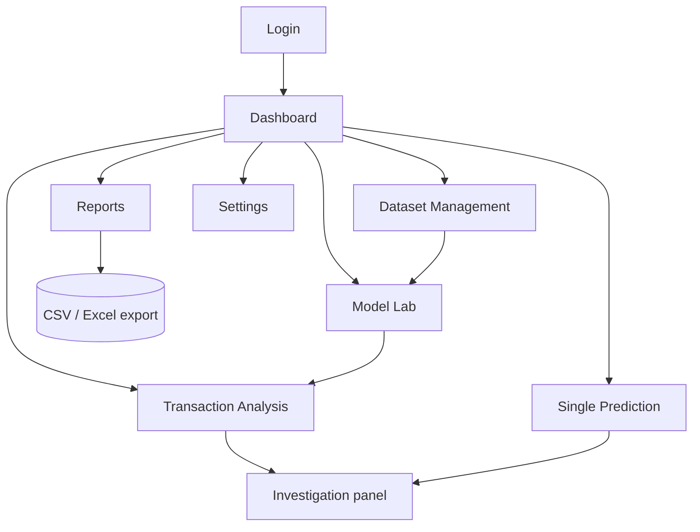

# 🖥️ UI Design

> Part of the [Intelligent Financial Fraud Detection Platform](../README.md) documentation.

Stack: **Next.js + TypeScript**, **Tailwind CSS**, **Recharts**. One user role: the fraud analyst.

## Navigation Map



## Pages

| Page | Main contents | Requirements |
|---|---|---|
| **Login** | Single-user authentication | FR-01 |
| **Dashboard** | Dataset summary, transaction totals, model status, risk distribution, model metrics | FR-09 |
| **Dataset Management** | Upload, schema validation, preview, missing values, duplicates, class balance | FR-02, FR-03 |
| **Model Lab** | Choose model, train, evaluate, compare | FR-05, FR-06 |
| **Transaction Analysis** | Search/filter, prediction, probability, anomaly signal | FR-07, FR-08, FR-10 |
| **Single Prediction** | Enter supported feature values or upload one-row file | FR-07 |
| **Reports** | Export model comparison and prediction summaries | FR-11 |
| **Settings** | Risk thresholds, preprocessing options, preferences | Threshold policy |

## Wireframe: Dashboard

```text
┌──────────────────────────────────────────────────────────────────────────┐
│ ☰  Fraud Detection Platform                              👤 Analyst ▾   │
├────────────┬─────────────────────────────────────────────────────────────┤
│ Dashboard  │  ┌─────────┐ ┌─────────┐ ┌─────────┐ ┌──────────────────┐   │
│ Datasets   │  │ Total   │ │ Flagged │ │ Anomaly │ │ Active model     │   │
│ Model Lab  │  │ txns    │ │ HIGH    │ │ records │ │ RF · v1          │   │
│ Analysis   │  └─────────┘ └─────────┘ └─────────┘ └──────────────────┘   │
│ Predict    │                                                             │
│ Reports    │  ┌──────────────────────────┐ ┌──────────────────────────┐  │
│ Settings   │  │ Risk distribution (bar)  │ │ Model comparison         │  │
│            │  │ LOW ▇▇▇▇▇▇▇▇▇▇           │ │ P / R / F1 / PR-AUC      │  │
│            │  │ MED ▇▇                   │ │ (grouped bars)           │  │
│            │  │ HIGH ▇                   │ │                          │  │
│            │  └──────────────────────────┘ └──────────────────────────┘  │
│            │  ⚠ Predictions are decision-support estimates, not proof.   │
└────────────┴─────────────────────────────────────────────────────────────┘
```

## Wireframe: Transaction Analysis + Investigation

```text
┌───────────────────────────────────────────────┬──────────────────────────┐
│ Filters: risk ▾  anomaly ▾  amount ▾  🔍 ref  │  Investigation           │
├──────┬──────────┬────────┬────────┬───────────┤  txn-0001                │
│ Ref  │ Prob.    │ Label  │ Anom.  │ Risk      │  Probability: 0.xx       │
├──────┼──────────┼────────┼────────┼───────────┤  Risk: HIGH              │
│ 0001 │ 0.xx     │ 1      │ 0.xx   │ 🔴 HIGH   │  Anomaly: unusual record │
│ 0002 │ 0.xx     │ 0      │ 0.xx   │ 🟢 LOW    │  ──────────────────────  │
│ 0003 │ 0.xx     │ 0      │ 0.xx   │ 🟡 MED    │  Top feature signals     │
│ …    │          │        │        │           │  (SHAP, if enabled)      │
└──────┴──────────┴────────┴────────┴───────────┴──────────────────────────┘
```

## UX Guidelines

- **Colors:** 🟢 LOW · 🟡 MEDIUM · 🔴 HIGH, and never rely on color alone (add text labels).
- Show **anomaly** as a separate badge from **fraud risk**.
- Show a persistent note: *"Model estimate for decision support, not proof of fraud."*
- Show clear, specific errors for invalid uploads and schema mismatches.
- Show progress status for long training jobs.
- Responsive layout via Tailwind; tables scroll horizontally on small screens.
- Explanations only use fields the dataset actually has (no invented merchant/device/location details).

## Component Inventory

| Component | Used in |
|---|---|
| `MetricCard` | Dashboard |
| `RiskDistributionChart` (Recharts) | Dashboard |
| `ModelComparisonChart` (Recharts) | Dashboard, Model Lab |
| `ConfusionMatrix` | Model Lab |
| `DataPreviewTable` | Dataset Management |
| `TransactionTable` + filters | Transaction Analysis |
| `InvestigationPanel` | Transaction Analysis, Single Prediction |
| `ThresholdSettingsForm` | Settings |
| `UploadDropzone` | Dataset Management, Single Prediction |
