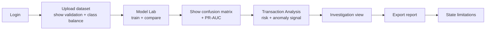

# 🎓 Viva Notes

> Part of the [Intelligent Financial Fraud Detection Platform](../README.md) documentation.

## Faculty-Ready Explanation

> "Our project aims to identify potentially fraudulent transactions by learning from labeled historical transaction data. We compare several classification algorithms and add anomaly detection to surface unusual patterns. The application displays model performance, estimated fraud probability and risk indicators through a single-user dashboard. It is an academic decision-support prototype and does not directly authorize or block real payments."

## 30-Second Pitch

1. **Problem:** too many transactions to review manually; fixed rules miss patterns.
2. **Solution:** supervised models estimate fraud probability; Isolation Forest flags unusual records.
3. **Evidence:** imbalance-aware metrics (PR-AUC, recall, precision), not accuracy alone.
4. **Honesty:** decision support only; limits of the dataset are documented.

## Likely Questions and Answer Guides

| Question | Key points for the answer |
|---|---|
| Why not just use accuracy? | Dataset is ≈ 0.173 % fraud; predicting all non-fraud gives ≈ 99.83 % accuracy and catches nothing |
| What is data leakage and how did you avoid it? | Information from test data influencing training; use `Pipeline`, fit scalers on training data only, isolated test set |
| Why PR-AUC? | More informative than ROC-AUC under severe imbalance because it focuses on the positive class |
| Which model is best? | Decided by validation results and cost of FP vs FN, not assumed beforehand |
| Is an anomaly the same as fraud? | No. Anomaly = unusual; fraud = labeled outcome. Shown as separate signals |
| What does K-Means do here? | Exploratory segmentation; clusters are not fraud labels |
| Why Isolation Forest? | Unsupervised; isolates points that differ from the observed distribution; useful when labels are scarce |
| How do you choose the threshold? | On validation data via the precision/recall trade-off and error costs |
| What are LOW/MEDIUM/HIGH? | Application-level categories from a documented, configurable threshold policy, not financial standards |
| Why is SVM tricky? | Training cost on the full dataset; use a documented sample or optimized configuration |
| What do V1–V28 mean? | Anonymized transformed features; we do not claim merchant/device/location data |
| Can it be deployed at a bank? | No. Needs privacy, compliance, security, monitoring and human-review controls |
| How is reproducibility ensured? | Recorded seed, dataset version, preprocessing, config, metrics; reload-consistency test |
| Why were experiments 4 and 6 skipped? | Linear regression and digit recognition don't fit transaction fraud classification |

## Glossary

| Term | Meaning |
|---|---|
| **Precision** | TP / (TP + FP): how many flagged are truly fraud |
| **Recall** | TP / (TP + FN): how many frauds were caught |
| **F1** | Harmonic mean of precision and recall |
| **PR-AUC** | Area under the precision-recall curve |
| **ROC-AUC** | Area under the ROC curve (TPR vs FPR) |
| **Stratified split** | Split preserving class proportions |
| **Data leakage** | Test information influencing training |
| **Class imbalance** | Very unequal class sizes |
| **Isolation Forest** | Tree-based anomaly detector |
| **SHAP** | Method assigning feature contributions to a prediction |
| **Decision support** | Advises a human; does not decide automatically |

## Demo Script

## Presentation Checklist

- [ ] Show class imbalance chart and explain the accuracy trap
- [ ] Show model comparison with metrics beyond accuracy
- [ ] Show FP vs FN trade-off and chosen threshold
- [ ] Show anomaly signal separate from fraud prediction
- [ ] State limitations and the decision-support disclaimer
